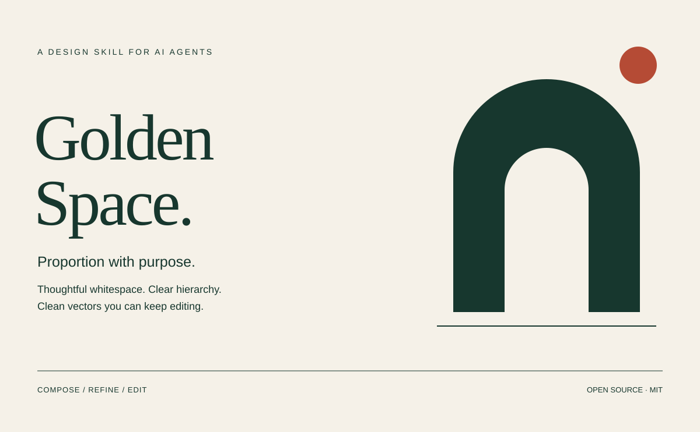
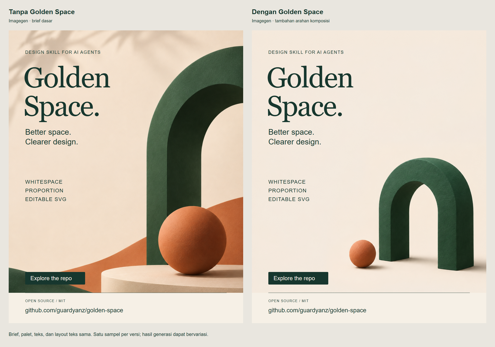

# Golden Space

**Skill untuk AI agent yang mengatur proporsi, whitespace, hierarki visual,
dan pembuatan SVG yang rapi serta tetap mudah diedit.**

[English](README.md) · [Instruksi skill](skills/golden-space/SKILL.md) · [Lisensi MIT](LICENSE)



Skill ini menerapkan batasan desain saat agent membuat poster atau gambar, lalu
meminta agent meninjau dan memperbaiki hasilnya. Cakupannya meliputi golden ratio,
whitespace, hierarki, tipografi, warna, alignment, ritme, dan keseimbangan optis.
Permintaan membuat desain harus menghasilkan artefak visual, bukan berhenti pada
saran atau prompt.

**Hasil akhir bisa SVG atau raster.** Pengguna dapat meminta SVG editable, PNG,
JPEG, atau WebP; skill mengikuti pilihan itu. Tidak wajib memberikan kedua format.
Poster raster juga dapat disusun dalam SVG terlebih dahulu lalu diekspor ke format
gambar yang diminta.

Untuk poster, social graphic, ilustrasi, diagram, dan ikon yang cocok dibuat dalam
bentuk vektor, hasil default langsung berupa **file `.svg` editable**, meskipun
pengguna tidak menyebut SVG. Agent menyimpan file jika alat penulisan file tersedia,
dan dapat menyertakan preview PNG jika bisa merender. Format yang secara eksplisit
diminta pengguna tetap diutamakan.

Untuk fotografi atau gambar dengan tekstur lukisan, aturan komposisi diterjemahkan
ke arahan image generator: posisi fokus, margin aman, ruang kosong, palet, dan area
teks. Hasilnya tetap diperiksa secara visual. Foto yang dimasukkan ke dalam SVG
tetap berupa raster; versi vektor tersendiri atau layout hybrid dapat dibuat sesuai
kebutuhan dan harus dijelaskan sifatnya.

Golden ratio dipakai sebagai pilihan proporsi sesuai kebutuhan konten. Agent
diminta membandingkannya dengan komposisi lain. Tidak ada persentase whitespace
yang wajib, spiral dekoratif wajib, atau gaya visual yang harus selalu ditiru.

## Pasang

Dengan [Skills CLI](https://github.com/vercel-labs/skills) dan versi Node.js yang didukung:

```sh
npx skills add guardyanz/golden-space --skill golden-space
```

Pilih agent tujuan di installer. Untuk pemasangan manual, clone repo lalu salin
**seluruh folder** `skills/golden-space` ke direktori skill milik agent. Folder
referensi, aset, dan skrip harus tetap bersama `SKILL.md`. Untuk mencoba tanpa
memasang, minta agent membaca file tersebut dan mengikutinya untuk tugas saat ini.

Formatnya mengikuti [Agent Skills](https://agentskills.io/specification). Cara
memanggil dan lokasi pemasangan mengikuti masing-masing agent. Pemeriksa SVG
membutuhkan Python 3.10+ tanpa paket tambahan; instruksi skill tetap bisa dipakai
tanpa Python.

## Contoh pemakaian

Di Codex:

```text
Gunakan $golden-space untuk membuat poster pameran keramik ukuran 1200 x 742.
Teks: "Clay / Form / Space", "12-14 June", "Studio 04". Pakai palet hangat.
```

Brief yang cocok untuk vektor seperti ini langsung menghasilkan file SVG editable
tanpa perlu permintaan ekspor terpisah. Untuk arahan yang lebih spesifik:

```text
Gunakan $golden-space untuk membuat poster Plant Swap ukuran 1080 x 1350.
Hasil akhir PNG saja. Teks: "Plant Swap", "Saturday 09:00", "Community Garden".
Gunakan dua warna hijau dan latar hangat, dengan judul yang menonjol.
```

```text
Gunakan $golden-space untuk membuat poster pameran keramik berukuran 1200 x 742.
Bandingkan golden ratio dengan rule of thirds, pilih yang cocok untuk konten.
Buat SVG lengkap dengan teks editable, objek terpisah, dan grup yang jelas.
Gunakan warna netral hangat dan whitespace yang lega.
```

```text
Gunakan $golden-space untuk merapikan SVG ini. Pertahankan teks dan identitas
visualnya, benahi grouping dan ID objek, lalu periksa dependensi eksternal.
Jelaskan jika ada perubahan yang memengaruhi tampilan.
```

Pada agent lain, pilih skill melalui cara pemanggilan yang didukung atau rujuk
langsung `SKILL.md`.

## Makna SVG editable

- Objek tetap berupa geometri vektor dengan bagian yang bisa dipilih terpisah.
- Teks pada master tetap berupa `<text>` / `<tspan>`, bukan outline.
- Grup dan ID objek jelas, dengan struktur yang dangkal.
- Tidak memakai bitmap tersembunyi, script, aset eksternal, atau efek filter pada master portabel.
- Salinan outline untuk distribusi, bila diperlukan, dibuat sebagai file terpisah.

Tampilan font bisa berbeda antar komputer. SVG yang lolos pemeriksaan struktur
masih perlu dirender dan diuji di editor tujuan sebelum diklaim kompatibel.
Pemeriksa ini tidak menilai keindahan, geometri, atau seluruh aspek aksesibilitas,
dan bukan sanitizer keamanan.

## Isi repo dan pemeriksaan

Tersedia [aturan komposisi](skills/golden-space/references/composition.md),
[arahan image generator](skills/golden-space/references/image-direction.md),
[kontrak SVG](skills/golden-space/references/svg-contract.md), contoh SVG
original, [skenario evaluasi](evals/scenarios.md), serta pemeriksa struktur:

```sh
python skills/golden-space/scripts/check_svg.py desain.svg
python skills/golden-space/scripts/check_svg.py --strict --json desain.svg
python -m unittest discover -s tests -v
```

Mode biasa gagal jika ada error. `--strict` juga gagal pada warning yang perlu
ditinjau. Dokumentasi teknis dan batasan lengkap tersedia pada [README Inggris](README.md).
Seluruh instruksi, skrip, dan contoh SVG dalam repo ini menggunakan lisensi MIT.

Lihat contoh poster dalam [SVG](examples/plant-swap.svg) atau [PNG](examples/plant-swap.png),
[mark PNG transparan](examples/balanced-mark.png), dan
[catatan verifikasi](evals/results.md) untuk pengujian yang benar-benar dilakukan.

## Perbandingan memakai imagegen

[Lihat promo tanpa dan dengan Golden Space](examples/promo-comparison/README.md).
Keduanya memakai imagegen, brief, palet, teks, dan layout teks yang sama. Versi
Golden Space menambahkan arahan ruang kosong, margin aman, proporsi, dan posisi
subjek. Versi tanpa skill tetap dibuat dengan baik.



Tersedia PNG dan SVG hybrid untuk masing-masing versi, berikut gambar asli dan
prompt lengkap. Teks SVG tetap editable; artwork hasil imagegen tetap raster.
Ada pula versi SVG murni beserta PNG-nya, dengan tekstur yang disederhanakan.
Ini contoh satu sampel per versi, bukan benchmark atau jaminan peningkatan kualitas.
