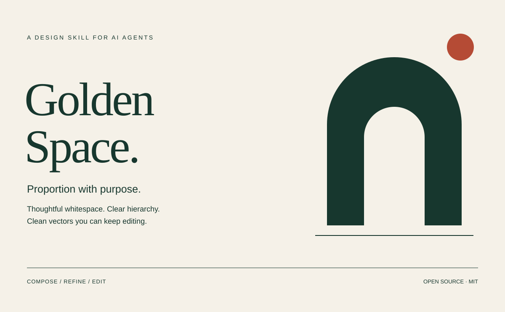

# Golden Space

**A design skill for AI agents: purposeful proportions, thoughtful whitespace,
and clean SVG source you can keep editing.**

[Bahasa Indonesia](README.id.md) · [Skill instructions](skills/golden-space/SKILL.md) · [MIT license](LICENSE)



Golden Space turns design principles into decisions an agent can use while making
posters, diagrams, illustrations, icons, and layout studies. It covers golden ratio,
spacing, hierarchy, typography, color, alignment, rhythm, and optical balance.

Golden ratio is an optional compositional relationship. The skill asks the agent
to compare it with other layouts and keep it when it serves the content. There is
no required spiral, universal whitespace percentage, or prescribed visual style.

For SVG work, the default deliverable is a self-contained vector master with live
text, separate objects, descriptive IDs, and simple semantic groups. Raster wrappers,
flattened text, external assets, scripts, and filter effects are excluded from the
portable master. Exact rendering still depends on fonts and editor support.

## Install

With the [Skills CLI](https://github.com/vercel-labs/skills) and a supported Node.js version:

```sh
npx skills add guardyanz/golden-space --skill golden-space
```

Choose the target agent in the installer. The repository uses the
[Agent Skills format](https://agentskills.io/specification); agent-specific discovery
paths and invocation behavior vary. The bundled Python checker requires Python 3.10+
and no third-party Python packages. The instructions themselves do not require Python.

For manual installation, clone the repository and copy the **whole**
`skills/golden-space` directory into your agent's skills directory. Keep `references`,
`assets`, and `scripts` beside `SKILL.md`. To try it without installing, ask your agent
to read that `SKILL.md` and follow it for the current task.

## Use

In Codex, invoke `$golden-space` with a brief. In another agent, select the installed
skill through its supported invocation mechanism, or explicitly reference `SKILL.md`.

```text
Use $golden-space to create a 1200 x 742 editorial SVG poster for a ceramics
exhibition. Compare a 61.8/38.2 split with thirds, choose what suits the copy,
keep the text editable, and deliver the complete SVG. Use a warm neutral palette.
```

```text
Use $golden-space to review this layout. Improve the grouping and whitespace
while preserving the brand, wording, and dimensions. Explain the main changes.
```

```text
Use $golden-space to clean this SVG for editing. Preserve the live text,
separate the illustration components, name the objects, and remove external
dependencies. Report any visual tradeoffs before changing an essential effect.
```

The skill does not publish files, install fonts, or authorize unrelated actions.

## What is included

| Resource | Purpose |
| --- | --- |
| [SKILL.md](skills/golden-space/SKILL.md) | Main instructions and workflow |
| [Composition reference](skills/golden-space/references/composition.md) | Ratios, spacing, hierarchy, optical balance, color |
| [SVG contract](skills/golden-space/references/svg-contract.md) | Editable structure and portable master conventions |
| [Starter SVG](skills/golden-space/assets/starter.svg) | Live text and grouped arch illustration |
| [Whitespace study](examples/whitespace-study.svg) | Equal columns and proximity-based grouping |
| [Balanced mark](examples/balanced-mark.svg) | Transparent, separate vector components |
| [SVG checker](skills/golden-space/scripts/check_svg.py) | Read-only structural lint, with text and JSON reports |
| [Evaluation scenarios](evals/scenarios.md) | Briefs and observable criteria for testing agent behavior |

All three SVGs are original examples licensed under MIT. Their typography uses font
stacks, not bundled fonts. Substitute fonts may change line lengths and appearance.
The examples demonstrate structure and composition; they are not mandatory templates.

## Check an SVG

From the repository root:

```sh
python skills/golden-space/scripts/check_svg.py artwork.svg
python skills/golden-space/scripts/check_svg.py --strict --json artwork.svg
python -m unittest discover -s tests -v
```

The checker reports malformed XML, invalid canvas dimensions, missing object IDs,
duplicate IDs, broken local references, excluded elements, external resources, and
other violations of this project's editable profile. Review warnings cover features
such as linked instances or masks. Ordinary mode fails on errors; `--strict` fails
on warnings too. `--json` returns a `passed` flag and per-file issue lists.

This is a conservative authoring profile, not a validator for the entire SVG standard
or a security sanitizer. A clean report does not prove correct geometry, contrast,
good composition, or editor compatibility. Render at intended size and inspect the
source in the target editor before claiming those checks passed. Keep a live-text
master if you also need an outlined distribution copy.

Technical references are linked in the [composition guide](skills/golden-space/references/composition.md)
and [SVG contract](skills/golden-space/references/svg-contract.md). Contributions should
include a concrete brief and explain which observable result improves; see
[CONTRIBUTING.md](CONTRIBUTING.md).
