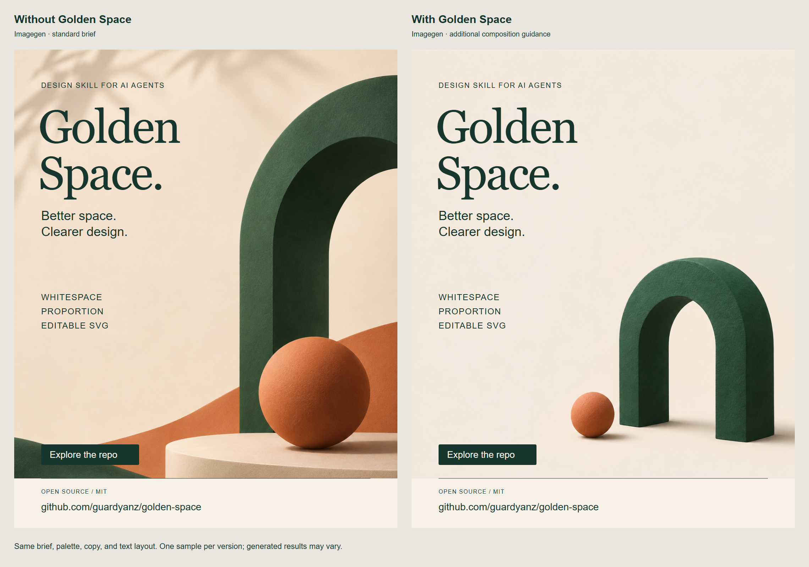

# Imagegen with and without Golden Space

Two repository-promotion posts from the same brief, made with the built-in
`image_gen` tool. The right-hand version adds Golden Space art direction.



## Downloads

| Version | Final PNG, 1080 x 1350 | Editable layout SVG |
| --- | --- | --- |
| Imagegen without Golden Space | [PNG](without-golden-space.png) | [Hybrid SVG](without-golden-space.svg) |
| Imagegen with Golden Space | [PNG](with-golden-space.png) | [Hybrid SVG](with-golden-space.svg) |
| Side-by-side comparison | [PNG, 2280 x 1600](comparison.png) | [SVG](comparison.svg) |

Fully vector interpretations, with matching raster exports:

| Version | Vector SVG | PNG rendered from the vector SVG |
| --- | --- | --- |
| Without Golden Space | [SVG](without-golden-space-vector.svg) | [PNG](without-golden-space-vector.png) |
| With Golden Space | [SVG](with-golden-space-vector.svg) | [PNG](with-golden-space-vector.png) |

**The promo SVGs are hybrid layouts.** Their copy, CTA, footer, and groups are
editable SVG objects. Each artwork layer is an embedded PNG, not independently
editable vector geometry. The PNG exports are renders of those SVG layouts, so
each PNG/SVG pair represents the same composition. The comparison-board SVG embeds
the two final posts; its labels remain live text.

For a fully vector example, use the repository's [plant-swap poster](../plant-swap.svg).
These raster-backed promo files intentionally sit outside the strict vector-master
profile checked by `check_svg.py`.

The `-vector.svg` companions recreate the principal shapes and composition with
independent paths, circles, live text, and local gradients. They contain no raster.
Their `-vector.png` files match those interpretations. They simplify the generated
surface texture and lighting; they are deliberately authored vector interpretations,
not lossless conversions or automatic traces of the imagegen artwork.

## What was held constant

- The [shared brief](prompts/common-brief.md), subject, palette, intended audience,
  final copy, and final post dimensions.
- The same built-in image-generation tool, with one new-image call per variant
  and no reference image. The tool did not expose a seed or a model-version control.
- The same live-text overlay, fonts, font sizes, positions, feature list, CTA, and
  footer in both layouts. Neither version was intentionally made worse.
- Original generated artwork was retained without retouching. Both SVG layouts use
  the same centered cover behavior to fit the artwork into the final canvas.

The source artwork returned by the tool is 1122 x 1402 in both cases, rather than
the suggested 1024 x 1280 prompt size. The final PNG exports are exactly 1080 x 1350.

## What changed

The [baseline prompt](prompts/without-golden-space.txt) requests a polished, attractive
promotional composition and room for copy using ordinary imagegen direction.

The [Golden Space prompt](prompts/with-golden-space.txt) includes that same request,
then adds a protected copy area, safe perimeter, subordinate accent, explicit
lower-right subject placement, negative-space relationships, and an approximate
golden relationship between quiet and dense regions. The prompt does not request
a visible golden spiral or claim mathematically exact placement in the raster.

This comparison therefore isolates **additional image art direction**. It does not
measure improvements from changing typography, because the overlay is identical.

## Reading this sample

In these particular outputs, the baseline has a larger arch cropped at the upper
and right edges, extra foreground forms, and a shadow texture in the copy area.
It has a more immersive, close-cropped character.

The directed version leaves more uninterrupted space for the title, shows the
whole arch within the canvas, and separates the small sphere from the arch.
That makes its imagery less competitive with the fixed promo copy. Both are
legitimate visual approaches; preference depends on the intended message.

This is a transparent, one-sample illustration of a workflow, **not a controlled
benchmark or proof of universal quality improvement**. Generative variation and
prompt specificity affect the result. No aesthetic scores, engagement claims,
or conversion claims were measured.

## Files and rebuilding

The unmodified generated layers are in [assets](assets/). Exact prompts are in
[prompts](prompts/), and [generation.json](generation.json) records the tool path,
sample counts, and source/prompt hashes. Generation used the built-in tool, not
the fallback CLI/API path.

Run from the repository root:

```sh
python examples/promo-comparison/build.py
```

This regenerates the two hybrid SVGs and the generation record from the saved
artwork, plus both vector interpretations, without an image API call. Export each
promo SVG to PNG at 1080 x 1350 with a
renderer such as Chromium or Inkscape. Run the builder again after those PNGs
exist to rebuild the comparison SVG, then export it at 2280 x 1600.

Rendering was checked in Chromium. Font stacks use Georgia / Times New Roman and
Arial / Helvetica, with generic fallbacks; no font files are bundled. Import and
editing in a dedicated vector editor were not tested.

[Verification details](verification.json) confirm that both final PNGs decode at
the requested dimensions, the embedded artwork matches the source, IDs are unique,
the text/vector overlay trees are identical, all nine live-text objects stay within
the canvas, and a text object can be changed independently in the browser DOM.
